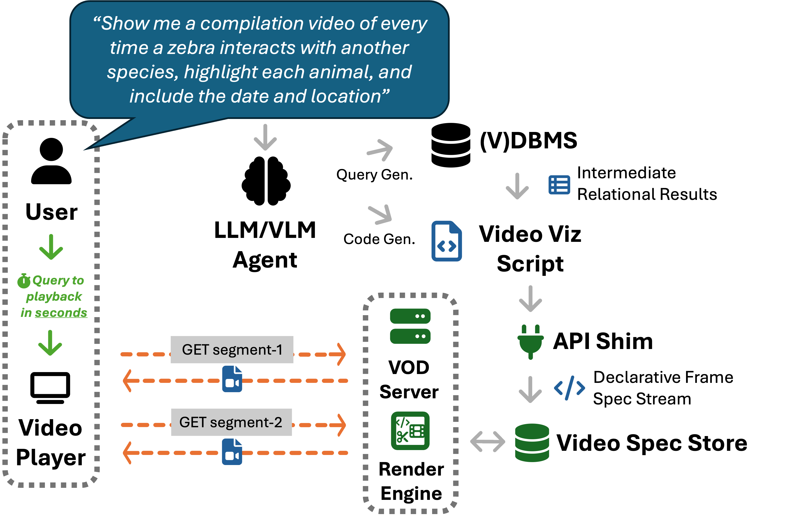

# vidformer

[](https://doi.org/10.1145/3767308.3836399)
[](https://arxiv.org/abs/2601.17221)
[](https://doi.org/10.5281/zenodo.19710152)
[](https://github.com/ixlab/vidformer/actions/workflows/test.yml)
[](https://pypi.org/project/vidformer/)
[](https://crates.io/crates/vidformer)
[](https://colab.research.google.com/github/ixlab/vidformer/blob/main/misc/Colab_Vidformer.ipynb)
[](https://github.com/ixlab/vidformer/blob/main/LICENSE)

Vidformer brings instant playback to data-edited videos, enabling rapid exploration of multimodal datasets.
See our ACM MM '26 paper, [*Vidformer: Enabling Instant Playback for Interactive Video Exploration*](https://doi.org/10.1145/3767308.3836399), or the [preprint on arXiv](https://arxiv.org/abs/2601.17221), for details.

Developed by the OSU Interactive Data Systems Lab.



## Quick Start

To quickly try out Vidformer you can:

*  [](https://colab.research.google.com/github/ixlab/vidformer/blob/main/misc/Colab_Vidformer.ipynb)
* try the online [Vidformer Playground](https://ixlab.github.io/vidformer/playground/)

Or, you can deploy it yourself:

```bash
git clone https://github.com/ixlab/vidformer
cd vidformer
docker build -t igni -f Dockerfile .
docker-compose -f vidformer-igni/docker-compose-local.yaml up
```

You can find details on this in our [Getting Started Guide](https://ixlab.github.io/vidformer/docs/getting-started.html).

## Why vidformer

Exploring multimodal datasets means editing videos with data: "show me every time X happens", "draw a box over each Y", "overlay Z telemetry on this video".
Scripts are the only tool expressive enough for these tasks, but they take minutes or hours to render.
Vidformer gives scripts the responsiveness of a video editor: just swap `import cv2` with `import vidformer.cv2 as cv2` and play the result instantly.

Vidformer combines three techniques:

* **Declarative Lifting:** An API shim runs your existing code with symbolic frames, recording a declarative specification of each output frame instead of rendering it.

* **Optimized Rendering:** With the full specification known in advance, the rendering engine transparently optimizes and parallelizes rendering, just like a relational database optimizes relational queries.

* **Video on Demand:** Result videos are served as a standard VOD stream, with each segment rendered just in time, so playback latency is independent of video length.

Vidformer usually renders videos 2-3x faster than cv2, and starts playback in 0.25-0.5 seconds (~400x faster) when serving videos on demand.
When operated by an LLM agent, Vidformer enables conversational video exploration: ask for a video in natural language and watch the result in seconds.

Vidformer builds on open technologies you may already use:
  * **OpenCV:** A `cv2`-compatible interface ensures both you (and LLMs) can use existing knowledge and code.
  * **Supervision:** [Supervision](https://supervision.roboflow.com/latest/)-compatible annotators make visualizing computer vision models trivial.
  * **FFmpeg:** Built on the same libraries, codecs, and formats that run the world.
  * **Jupyter:** View transformed videos instantly right in your notebook.
  * **HTTP Live Streaming (HLS):** Serve transformed videos over a network directly into any media player.
  * **Apache OpenDAL:** Access source videos no matter where they are stored.

## Documentation

* [🌐 Website](https://ixlab.github.io/vidformer/)
* [🌐 Docs](https://ixlab.github.io/vidformer/docs/)
* [🚀 Getting Started](https://ixlab.github.io/vidformer/docs/getting-started.html)
* [🐍 vidformer-py](https://ixlab.github.io/vidformer/vidformer-py/)
* [🛠️ vidformer core](https://ixlab.github.io/vidformer/vidformer/)

## About the project

**Cite:**
```bibtex
@inproceedings{winecki2026_vidformer,
  title     = {Vidformer: Enabling Instant Playback for Interactive Video Exploration},
  author    = {Winecki, Dominik and Nandi, Arnab},
  booktitle = {Proceedings of the 34th ACM International Conference on Multimedia},
  series    = {MM '26},
  year      = {2026},
  location  = {Rio de Janeiro, Brazil},
  publisher = {Association for Computing Machinery},
  address   = {New York, NY, USA},
  isbn      = {979-8-4007-2213-4},
  doi       = {10.1145/3767308.3836399},
  url       = {https://doi.org/10.1145/3767308.3836399},
}
```
An earlier version is available as a preprint on [arXiv](https://arxiv.org/abs/2601.17221).

**File Layout**:
- [*./vidformer*](./vidformer/): The core rendering library (Rust)
- [*./vidformer-py*](./vidformer-py/): The Python frontend
- [*./vidformer-igni*](./vidformer-igni/): The vidformer server
- [*./misc/vidformer-mcp*](./misc/vidformer-mcp/): An MCP server
- [*./misc/vidformer-slack*](./misc/vidformer-slack/): A slack bot
- [*./misc/tla*](./misc/tla/): A TLA+ model of the rendering engine
- [*./docs*](./docs/): The [project docs](https://ixlab.github.io/vidformer/docs/)

Vidformer components are detailed [here](https://ixlab.github.io/vidformer/docs/modules.html).

**License:** Vidformer is open source under [Apache-2.0](./LICENSE).
Contributions are welcome.

**Acknowledgements:** Supported by the Imageomics Institute (NSF Award #2118240) and NSF Award #1910356. Any opinions, findings and conclusions or recommendations expressed in the materials here are those of the author(s) and do not necessarily reflect the views of the National Science Foundation.
